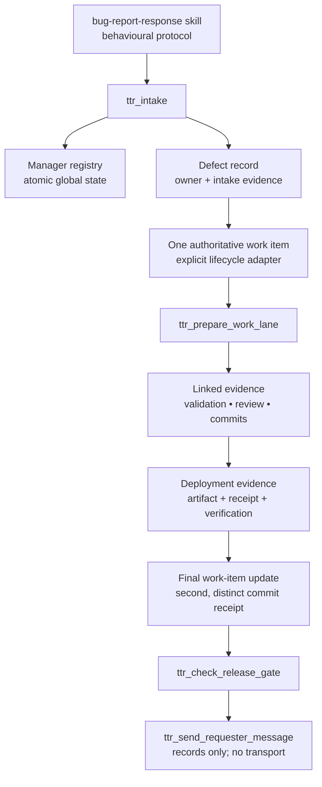

# Triage Control Plane (TTR)

Global Pi extension implementing the structured control-plane portions of `~/.agents/skills/bug-report-response/SKILL.md`. The skill remains responsible for triage, diagnosis, TDD, review, and orchestration behaviour; this extension tracks authoritative state and supported gates.

## Purpose

TTR makes the protocol's control plane durable and inspectable without replacing the policy skill or automating unsafe external actions. It answers four control questions before work advances:

1. **Who owns this defect domain?** The active designated Manager.
2. **What is the single tracking authority?** The defect's one authoritative work item.
3. **What evidence supports the next transition?** Linked intake, validation, review, commit, deployment, and requester-message evidence.
4. **May a supported release or safe-to-proceed action advance?** Only if the fail-closed release gate passes.

## Architecture



### Components

| Component | Responsibility |
| --- | --- |
| `index.ts` | Pi command and custom-tool registration; retrieves the supported Pi session ID and performs cwd-aware Git inspection. |
| `src/core.ts` | Testable domain model, atomic lock/file storage, Manager resolution, work-item invariants, evidence recording, and release-gate logic. |
| `explicit-lifecycle` adapter | Stores caller-configured repository lifecycle states. It does not infer statuses or edit repository backlog files. |
| `README.md` | Operational contract, boundaries, installation, and examples. |

## State and safety

- Durable global state: `$PI_CODING_AGENT_DIR/triage-control-plane/state.json` (default `~/.pi/agent/triage-control-plane/state.json`), written through an exclusive lock plus atomic temp-file rename with restrictive permissions.
- Manager session IDs come from `ctx.sessionManager.getSessionId()` (the documented session API); `/ttr register` never guesses one.
- **Admin authority is separate from Manager authority.** Bootstrap exactly one first admin by setting `TTR_ADMIN_SESSION_IDS` to a comma-separated explicit session-ID allowlist before loading TTR, then have that same session run `/ttr register --admin` while the persisted admin registry is empty. An enrolled active admin may enroll later admins with `/ttr register --admin --session-id <id>` or permanently revoke one with `/ttr unregister <id> --admin`; a deactivated bootstrap identity cannot self-enroll again. A Manager registration, domain, repository path, or intake report never grants admin authority.
- Pi provides `ctx.cwd`, but no semantic domain API. When omitted from a TTR command, the domain is deterministically derived from the Git repository root name, falling back to the current directory name; supply a domain explicitly to override it.
- Incoming `ttr_intake` reports must separately declare `sourceDomain`, `ownerDomain`, and `targetPocSessionId` (the retained compatibility field name for the target Manager). `ttr_intake_for_owner` keeps `sourceDomain` and `ownerDomain` explicit but atomically resolves the active target Manager. Neither tool infers ownership from the sender workspace or source domain.
- Secrets are not accepted in records or tools. Store only evidence references/paths, receipts, and commit SHA evidence.
- The built-in `explicit-lifecycle` adapter stores the caller-supplied lifecycle states alongside the authoritative ID/path. It intentionally does **not** invent repository status names or mutate a repository work item. A repository integration can implement the exported `WorkItemAdapter` seam.

## Enforcement boundaries

Enforced by supported TTR tools:

- one active Manager registration per canonical domain or alias, with atomic multi-alias registration and explicit confirmation before active Manager replacement; aliases are stored as a compact index to one canonical Manager record, and legacy same-session records are consolidated on read;
- evidence-only handoff generation when the resolved owner Manager, declared target Manager, and receiving session do not all match;
- `ttr_prepare_work_lane` refuses to produce a supported diagnosis/review/validation/implementation lane contract until the authoritative work item exists, and its emitted preamble must be passed to the lane;
- exactly one authoritative work-item reference per TTR defect, and only its configured lifecycle states;
- reassignment only by the active, addressed owner Manager, with a nonempty replacement ID/path/status/lifecycle, no same or colliding assignment, and append-only prior-item audit history containing a reason and evidence references;
- active, explicitly enrolled admins may inspect Managers, defects, assignment history, and computed orphan state; mark one Manager assignment orphaned only with reason/evidence; rebind it only to the active Manager session for its domain and an explicit validated work-item path; and supersede an obsolete item with a traceable successor while retaining the original;
- requester-message category validation and evidence recording;
- release-gate checks for authoritative item, clean Git tree, commit/validation/review evidence, deployment artifact/receipt/verification, final post-deployment item update, and linked **distinct** second commit evidence;
- `safe-to-proceed` only after the supported gate passes.

Not enforceable globally:

- direct arbitrary `subagent` calls cannot be reliably associated with a defect, so the extension cannot truthfully block every lane launched outside `ttr_prepare_work_lane`;
- generic inbound `intercom` messages cannot be intercepted by this extension. Pi-intercom injects them into a recipient through its own private inbound handler. The extension bus is opaque extension-channel traffic, not a generic-message hook.
- the extension does not attempt heuristic blocking of arbitrary `bash`, `user_bash`, deploy, publish, or manual messaging commands. Those paths may be warned about by process policy but cannot be truthfully claimed as fully blocked.
- `ttr_send_requester_message` records a permitted message only. It has **no external transport** and never sends email, chat, comments, deployments, publications, or releases.
- a clean Git tree and linked SHA evidence prove supported gate prerequisites, but cannot prove that arbitrary hidden/external changes are in scope. Deployment authorization remains human/repository process authority.

### Sender-side non-Manager handoff contract

`ttr_intake` returns a `targetSessionId`, `delivery: "not-attempted"`, and the minimal evidence-only payload. If and only if the Manager session is a known established reachable channel, use exactly the target emitted by the tool:

```ts
intercom({ action: "send", to: "<returned targetSessionId>", message: "<returned payload JSON>" })
```

Do not substitute a name, fabricate a target, or silently reroute an unreachable Manager. If reachability is unknown, keep the payload in TTR state and request an authorized replacement route.

## Commands

```text
/ttr register                                            # register this session as Manager for the current repository domain
/ttr register payments                                   # this session is Manager for an explicit domain
/ttr register pi-extensions ttr agent-workflows handoff  # register the same Manager for a canonical domain plus aliases
/ttr register payments --session-id <pi-session-id>      # explicit Manager; positional values remain domains/aliases
/ttr register payments ttr --replace                     # required to replace any active Manager in the set
/ttr status [domain] [--json]                           # Manager status; JSON for agent use
/ttr list [--active] [--json]                            # Manager table or JSON; --active hides inactive records
/ttr list --admin [--json]                               # enrolled-admin table or JSON; requires active admin
/ttr ui                                                  # interactive defect search, inspection, and admin reconciliation console
/ttr register --admin [--session-id <id>]                # enroll an admin; first enrollment requires bootstrap allowlist
/ttr unregister payments                                 # remove one domain; promotes another alias if needed
/ttr unregister payments --all                           # remove the entire Manager and every domain alias
/ttr unregister <session-id> --admin                     # active admin only; permanent revocation
/ttr deactivate                                          # temporarily stop routing while retaining the Manager record
/ttr deactivate payments                                  # re-register the domain to reactivate it
```

## Tool examples

```ts
// Record intake. `sourceDomain` is evidence context; only `ownerDomain` selects the TTR Manager.
// A receiver may start a supported lane only when targetPocSessionId resolves to that same receiver.
ttr_intake({
  reporter: "customer", source: "support:123", sourceDomain: "storefront",
  ownerDomain: "payments", targetPocSessionId: "<addressed-poc-session-id>",
  symptom: "card declined", impact: "checkout blocked", environment: "prod",
  reproduction: "submit Visa test card", evidenceReferences: ["ticket:123", "request:req-7"]
})

// Preferred when the owner domain is known: resolve its active Manager without copying a session ID.
// Fails with `/ttr register payments` guidance when no active Manager exists.
ttr_intake_for_owner({
  reporter: "customer", source: "support:123", sourceDomain: "storefront", ownerDomain: "payments",
  symptom: "card declined", impact: "checkout blocked", environment: "prod",
  reproduction: "submit Visa test card", evidenceReferences: ["ticket:123", "request:req-7"]
})

// One-time explicit migration for a legacy record created before the routing contract.
// Only the active owner Manager named by targetPocSessionId can re-attest it.
ttr_reattest_defect_authority({
  defectId: "ttr-…", sourceDomain: "babysitter-dv", ownerDomain: "ttr",
  targetPocSessionId: "<active-ttr-poc-session-id>"
})

// Before any diagnosis/design/implementation/review/validation/deployment lane:
ttr_assign_work_item({
  defectId: "ttr-…", workItemId: "BUG-123", workItemPath: "backlog/BUG-123.md",
  status: "in-progress", lifecycleStates: ["proposed", "in-progress", "ready-for-review", "closed"]
})

// Only the active, addressed owner Manager may replace an authoritative item. TTR preserves BUG-123 in immutable audit history.
ttr_reassign_work_item({
  defectId: "ttr-…", workItemId: "BUG-456", workItemPath: "backlog/BUG-456.md",
  status: "proposed", lifecycleStates: ["proposed", "in-progress", "closed"],
  reason: "duplicate tracker item", evidenceReferences: ["ticket:123"]
})

// Active TTR admins only. The first enrollment requires this session ID to be explicitly listed in TTR_ADMIN_SESSION_IDS.
ttr_register_admin({ sessionId: "<admin-session-id>" })
ttr_deactivate_admin({ sessionId: "<admin-session-id>" })
ttr_admin_lookup({})
ttr_mark_poc_assignment_orphaned({ defectId: "ttr-…", reason: "original Manager session deleted", evidenceReferences: ["incident:42"] })
// The target must be the active registered Manager for the defect domain; the work-item path is always explicit.
ttr_admin_rebind_work_item({ defectId: "ttr-…", targetPocSessionId: "<replacement-manager-session-id>", workItemId: "BUG-789", workItemPath: "backlog/BUG-789.md", status: "proposed", lifecycleStates: ["proposed", "in-progress", "closed"], reason: "recover orphan", evidenceReferences: ["incident:42"] })
// Supersession retains both the obsolete item and named successor in immutable audit history.
ttr_supersede_work_item({ defectId: "ttr-…", workItemId: "BUG-790", workItemPath: "backlog/BUG-790.md", status: "proposed", lifecycleStates: ["proposed", "closed"], reason: "BUG-789 obsolete", evidenceReferences: ["incident:43"] })

### Admin reconciliation playbooks

Use the admin tools—not direct edits to `state.json`—to repair routing records. They append audit history; they never delete the original defect or work-item record.

**Create an admin session:** Admin is not implied by Manager registration. For the **first** admin only, obtain that session's full Pi session ID (for example, `echo "$PI_INTERCOM_SESSION_ID"` where available), start/reload Pi with `TTR_ADMIN_SESSION_IDS=<that-full-id>`, then from that same session invoke:

```ts
ttr_register_admin({ sessionId: "<that-full-id>" })
```

After one active admin exists, do not use the bootstrap allowlist: an existing active admin invokes `ttr_register_admin({ sessionId: "<new-full-id>" })` to enroll another session. The first bootstrap call fails unless the admin registry is empty, the ID is allowlisted, and caller/target are identical. Never copy or edit `state.json` to bootstrap an admin.

**Orphaned Manager/session:** first inspect the defect and its computed assignment state, then mark the assignment orphaned with the incident reference. Rebinding deliberately fails until this explicit orphan step has happened.

```ts
const record = ttr_admin_lookup({ defectId: "ttr-…" })
ttr_mark_poc_assignment_orphaned({
  defectId: "ttr-…", reason: "Manager session was retired", evidenceReferences: ["incident:INC-42"]
})
ttr_admin_rebind_work_item({
  defectId: "ttr-…", targetPocSessionId: "<active replacement Manager session>",
  workItemId: "wi-006", workItemPath: "backlog/006-example.md", status: "ready",
  lifecycleStates: ["proposed", "ready", "in-progress", "ready-for-review", "closed"],
  reason: "restore ownership after session retirement", evidenceReferences: ["incident:INC-42"]
})
```

The replacement session must already be the active registered Manager for the defect domain. `ttr_admin_rebind_work_item` rejects another defect’s current item ID/path and retains the previous assignment/item snapshots in history.

**Obsolete work item:** when the active Manager is still valid but its current work item is wrong or replaced, use supersession instead. It retains the predecessor and links the named successor; it is not an authorization to start a lane or release.

```ts
ttr_supersede_work_item({
  defectId: "ttr-…", workItemId: "wi-007", workItemPath: "backlog/007-replacement.md", status: "ready",
  lifecycleStates: ["proposed", "ready", "in-progress", "closed"],
  reason: "canonical tracker replaced wi-006", evidenceReferences: ["tracker:wi-007"]
})
```

**Manager retirement:** `/ttr deactivate [domain]` is reversible; `/ttr unregister <domain> [--all]` removes routing. Each is permitted only to that Manager session or an active TTR admin. Use `ttr_deactivate_admin` only for permanent admin revocation.

// Required supported-lane preamble to pass into any diagnosis/review/validation/implementation lane:
ttr_prepare_work_lane({ defectId: "ttr-…", lane: "diagnosis" })

ttr_record_evidence({ defectId: "ttr-…", type: "validation", status: "passed", path: "evidence/repro.txt" })
ttr_record_evidence({ defectId: "ttr-…", type: "review", status: "passed", path: "evidence/review.md" })
ttr_record_commit_evidence({ defectId: "ttr-…", sha: "<commit-sha>", phase: "pre-deployment", path: "evidence/commit.json" })

// Records evidence for an already-authorized deployment; it never deploys.
ttr_record_deployment_evidence({ defectId: "ttr-…", artifact: "app@1.2.3", receipt: "deploy:42", verification: "healthcheck passed" })
ttr_transition_work_item({ defectId: "ttr-…", status: "closed", nextAction: "none" })
ttr_record_commit_evidence({ defectId: "ttr-…", sha: "<final-work-item-update-sha>", phase: "post-deployment", path: "evidence/final-commit.json" })
ttr_check_release_gate({ defectId: "ttr-…", deploymentRequired: true })

// Records an allowed message; it deliberately does not transmit it.
ttr_send_requester_message({ defectId: "ttr-…", category: "safe-to-proceed", message: "You may proceed. Monitoring is healthy.", deploymentRequired: true })
```

## Installation/reload

This extension is loaded through this package's `pi.extensions` manifest entry:

```text
extensions/triage-control-plane/index.ts
```

Install or link the `pi-extensions` package in Pi, then restart Pi or run `/reload`. For isolated load testing from the repository root:

```bash
pi -e extensions/triage-control-plane/index.ts
```

## Test

```bash
cd /path/to/pi-extensions
node --import tsx --test test/triage-control-plane.test.mjs test/triage-control-plane-core.test.mjs test/triage-control-plane-commands.test.mjs
```
